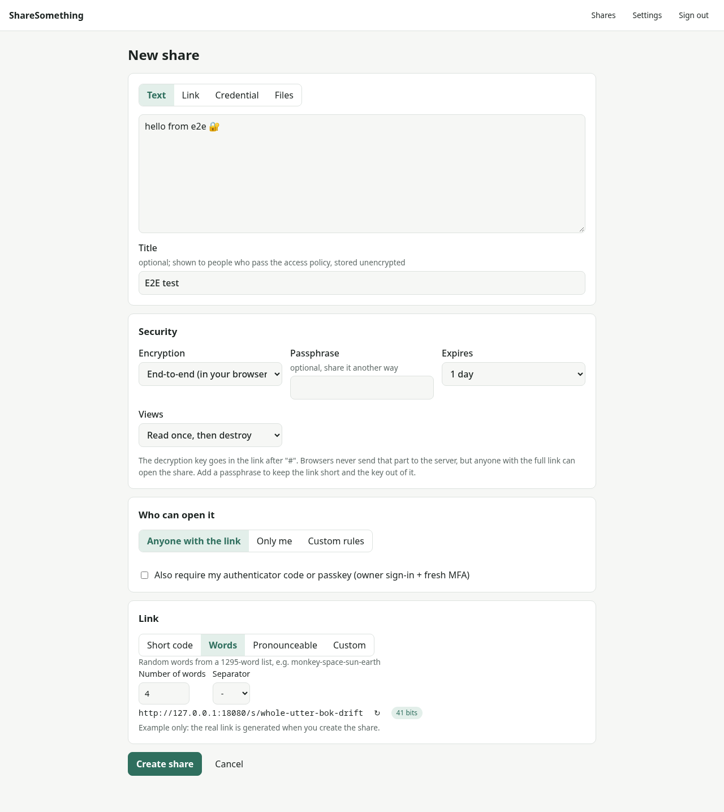
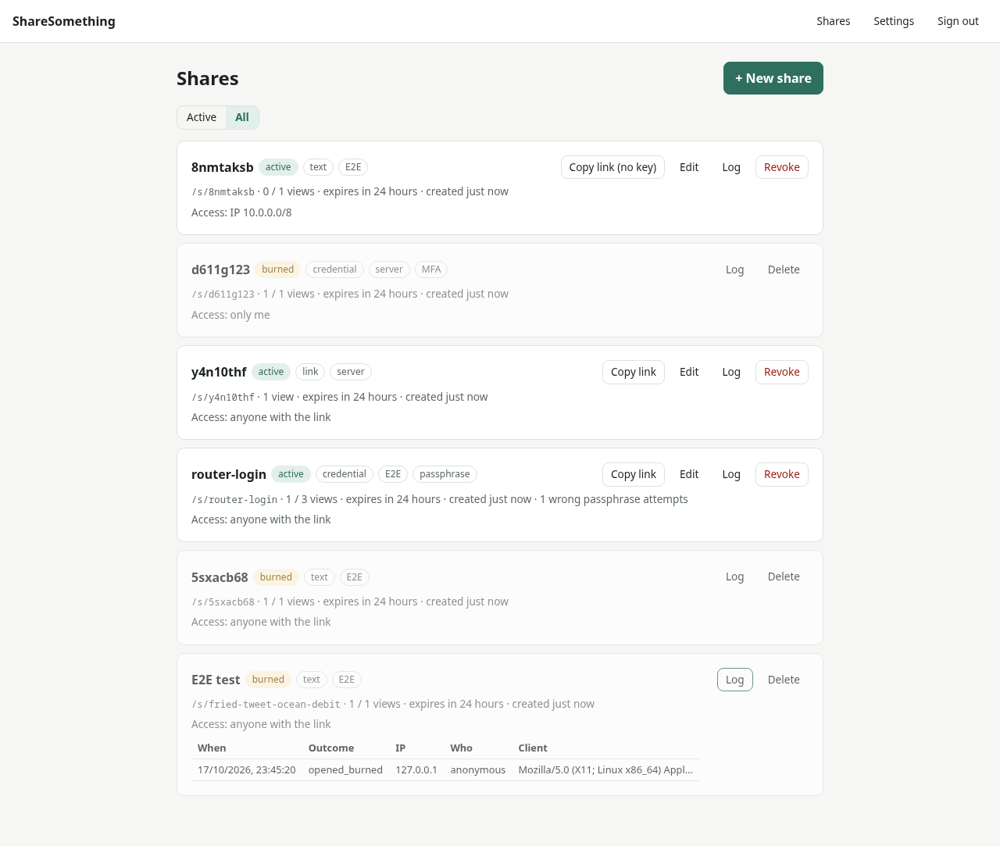
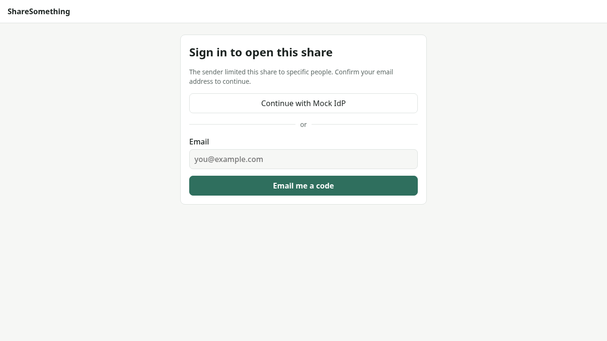
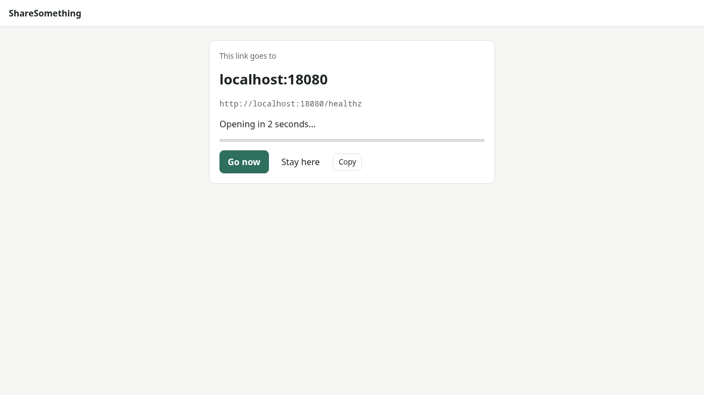
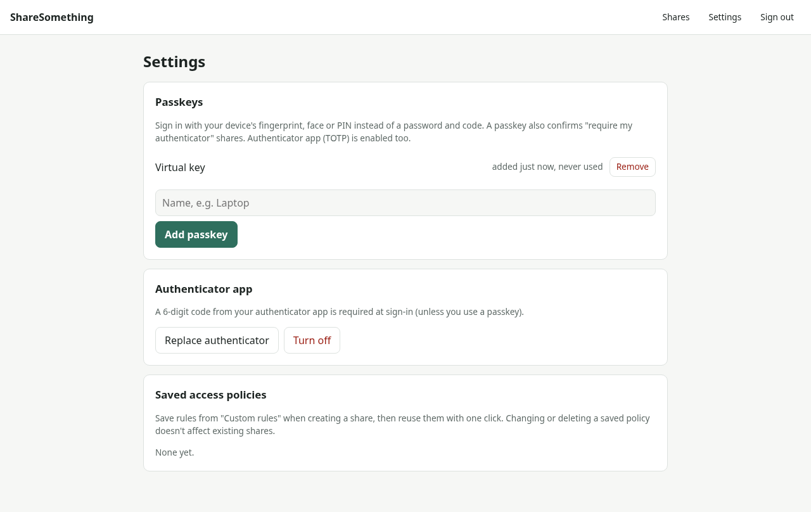

# ShareSomething

[](https://github.com/mnj/ShareSomething/actions/workflows/ci.yml)
[](LICENSE)
[](https://mnj.github.io/ShareSomething/)

**Self-hosted sharing of text, links, credentials and files, where every share gets its own
security settings.** It's a single Rust binary with a React UI and a SQLite file, built to run
behind a Cloudflare Tunnel or a reverse proxy.

Most "secret sharing" tools use one setting for everything. ShareSomething lets you choose per share:

| Use case | Settings |
|---|---|
| Move an API key between your own PCs | **Only me**, fresh passkey/TOTP required, read once |
| Wi-Fi password for a guest | Short link `/s/wifi-guest`, passphrase told in person, expires tonight |
| Doc link for the team | Anyone on the office IP range, unlimited views, 30 days |
| Contract PDFs for a client | Anyone `@client.com` who confirms an emailed code or signs in with Google, 3 downloads |
| A short link, like a URL shortener | `/s/launch` shows the target for 5 seconds, then opens it |

<p align="center">
  
</p>

## Features

**Encryption, chosen per share**
- **End-to-end:** encrypted in the browser with AES-256-GCM. The key travels in the link's
  `#fragment`, which browsers never send to the server, or is derived from a passphrase with
  argon2id. The server only ever stores ciphertext.
- **Server-side:** a per-share key, wrapped with a master key. A passphrase can be mixed into
  the wrapping.

**Limits and burn-after-reading**
- Read once, N views, or an expiry time. Content is wiped, not just hidden.
- Opening needs an explicit **Reveal**, so link previews in Slack or Teams can't burn a share.
- Too many wrong passphrases destroy the share.

**Access policies**, modelled on Cloudflare Access
- *Allow if* (any matches), *Require* (all must match) and *Block if* rules.
- Rule types: everyone, owner, IP/CIDR, country, email address and email domain.
- **Recipient sign-in:** an emailed one-time code, OIDC (Google, Microsoft, Keycloak,
  Authentik, ...) or GitHub. A rule can insist on a specific method.
- **Owner MFA per share:** require a fresh passkey or authenticator code to open a share.
- **Saved policies:** store a rule set such as "Office network" and reuse it with one click.

**Share modes**
- **Owner approval:** each open waits until you approve it live, notified in-app, by email or by
  a Slack/Teams webhook. Good for break-glass credentials.
- **Time-lock:** nothing is released before a chosen time, e.g. a handover on someone's start date.
- **Split key (k-of-n):** the key is split between key holders in the browser (Shamir). Any k of
  them together can open it, and neither one person alone nor the server can.
- **Notify on open:** know when (and from where) a share was opened.

**Content types**
- Text, links, multi-field credentials (secret fields masked) and files.
- **Files:** drag & drop several. They're encrypted in 1 MiB chunks and stream to disk on
  download, through the File System Access API, a service worker or the browser's download
  manager, so large files never sit in memory.
- **Redirect links:** show the destination prominently, then open it after a countdown, with
  *Go now* and *Stay here* buttons.

**Links**
- Pluggable link styles: short code (`k7m2qx9d`), words (`monkey-space-sun-earth`),
  pronounceable (`bafoki-turesa`), GUID (`3f2b6c1e-…`), template (`acme-{word}-{digits:4}` gives
  `acme-otter-4821`) or your own `wifi-guest`. Each comes with a "how guessable is this" hint.

**For you, the owner**
- Passkeys and/or an authenticator app (TOTP), both set up from the web UI.
- A dashboard with status, view counts and a per-share access log. You can edit, revoke or
  delete any share.

**Audit and compliance**
- A tamper-evident (hash-chained) audit trail of every sign-in, share action, open, refusal and export.
- Admins and a read-only **auditor** role can filter it, verify it and export it (CSV/JSONL).
- **SIEM streaming:** Splunk HEC, Elastic `_bulk`, syslog over TLS (CEF/JSON) for Sentinel, QRadar
  and ArcSight, webhooks with HMAC, files and stdout. Delivery is at-least-once with per-shipper
  cursors. See [docs/audit.md](docs/audit.md).

**Operations**
- A distroless image of about 22 MB with one `/data` volume.
- Trusted-proxy-aware client IPs for cloudflared, Caddy, nginx and Traefik.
- The OpenAPI spec is served at `/api/openapi.json`.

<table>
  <tr>
    <td></td>
    <td></td>
  </tr>
  <tr>
    <td></td>
    <td></td>
  </tr>
</table>

## Quick start

```sh
docker build -t sharesomething https://github.com/mnj/ShareSomething.git
docker run -d --name sharesomething -p 8080:8080 -v ss-data:/data \
  -e SS_BASE_URL=http://localhost:8080 sharesomething
docker exec -it sharesomething sharesomething admin init   # owner password + authenticator QR
```

Then open <http://localhost:8080>. For a real deployment, put it behind TLS. The two setups below
are ready to use.

### Behind a Cloudflare Tunnel (no open ports)

```sh
# Zero Trust > Tunnels: add a public hostname pointing to http://sharesomething:8080,
# then set SS_BASE_URL in deploy/compose.cloudflared.yml to that hostname.
TUNNEL_TOKEN=... docker compose -f deploy/compose.cloudflared.yml up -d
docker compose -f deploy/compose.cloudflared.yml exec sharesomething sharesomething admin init
```

### Behind Caddy (automatic HTTPS)

```sh
# edit deploy/Caddyfile and SS_BASE_URL first
docker compose -f deploy/compose.caddy.yml up -d
docker compose -f deploy/compose.caddy.yml exec sharesomething sharesomething admin init
```

`admin init` can run non-interactively: set `SS_ADMIN_PASSWORD` and the TOTP secret is printed.
Other commands are `admin set-password` and `admin reset-totp [--disable]`. After that, add
passkeys and manage the authenticator app under **Settings**.

## Configuration

Everything can be set with `SS_*` environment variables (use `__` for nesting) or a TOML file
passed with `--config`. [`config.example.toml`](config.example.toml) documents every option.
The important ones:

| Variable | Meaning |
|---|---|
| `SS_BASE_URL` | Public URL. Builds links, drives the CSRF origin check, and turns on Secure cookies for https. Passkeys need a domain name here. |
| `SS_PROXY__MODE` | `none`, `cloudflare` (`CF-Connecting-IP`) or `forwarded` (`X-Forwarded-For`) |
| `SS_PROXY__TRUSTED_PROXIES` | CIDRs allowed to set those headers, e.g. the tunnel's Docker network |
| `SS_MASTER_KEY` | Base64 32-byte key for server-side encryption (otherwise generated in `/data/master.key`) |
| `SS_EMAIL__MODE` | `disabled`, `log` (development) or `smtp`, plus `SS_EMAIL__SMTP_HOST`, `..._USERNAME`, `..._PASSWORD`, `SS_EMAIL__FROM` |
| `SS_OIDC` | Sign-in providers, e.g. `[{id="google",name="Google",issuer="https://accounts.google.com",client_id="…",client_secret="…"}]` |

For each OIDC or GitHub provider, register `<SS_BASE_URL>/api/recipient/oidc/<id>/callback` as the
redirect URI.

> **Back up `/data`.** If you didn't set `SS_MASTER_KEY`, that includes `master.key`. Without it,
> server-encrypted shares can't be decrypted. End-to-end shares never depend on it.

## How it works

```mermaid
flowchart LR
  subgraph Browser
    UI[React UI] -- "E2E: AES-GCM + argon2id<br/>key stays in #fragment" --> UI
  end
  UI -- "JSON API + chunked uploads" --> API
  subgraph Server["sharesomething (single binary)"]
    API[axum API] --> P{"policy::evaluate<br/>include / require / exclude"}
    P --> S[(SQLite)]
    API --> B[(encrypted blobs)]
  end
  IdP[OIDC / GitHub] <-. recipient sign-in .-> API
  SMTP[SMTP] <-. one-time codes .- API
  CF[cloudflared / Caddy] --> API
```

- **Backend** (`backend/`): Rust with axum, sqlx/SQLite and utoipa. It also serves the embedded
  frontend build.
- **Frontend** (`frontend/`): React with TypeScript and Vite. Its API types are generated from the
  backend's OpenAPI spec.
- Every way to open a share goes through one pure function, `policy::evaluate`. Views are spent
  with a single conditional `UPDATE`, so two people opening a read-once share at the same moment
  can't both get it.

### Security model

- **E2E shares:** the server never sees the plaintext, the key or the passphrase. A verifier
  derived from the passphrase lets the server reject a wrong passphrase *before* spending a view,
  so a typo can't burn a read-once share.
- **Proxy headers:** forwarding headers are ignored unless they come from a trusted proxy, so IP
  rules can't be bypassed by spoofing `X-Forwarded-For`.
- **Owner sessions:** HttpOnly, SameSite=Strict cookies plus an Origin check. TOTP codes can't be
  replayed. Passkeys use WebAuthn with user verification.
- **Recipient sign-in only ever proves an email address.**
  - Codes are only emailed to addresses that could pass the share's rules, and the response never
    reveals which addresses those are.
  - OIDC uses PKCE, a nonce and browser-bound state, and only provider-verified emails count.
- **File chunks** are tied to their file, position and "last chunk" flag by the AEAD, so they
  can't be reordered or truncated without detection.
- **Hardening:** a strict CSP with no inline scripts, `Referrer-Policy: no-referrer`,
  `Cache-Control: no-store` on the API, and per-IP rate limits.

[AGENTS.md](AGENTS.md) lists the full set of invariants that changes must keep.

## Development

```sh
# backend (terminal 1)
SS_DATA_DIR=./data SS_ADMIN_PASSWORD='dev-password-123' cargo run -- admin init
SS_DATA_DIR=./data SS_BASE_URL=http://localhost:5173 cargo run

# frontend (terminal 2)
cd frontend && npm install && npm run dev      # http://localhost:5173, proxies /api
```

| | |
|---|---|
| Backend tests | `cargo test`: HTTP integration tests, including a mock OIDC provider and real WebAuthn ceremonies with a software passkey |
| Frontend tests | `cd frontend && npm test` (browser crypto) |
| API types | `cd frontend && npm run gen:api` after changing backend DTOs |
| Lint | `cargo clippy --all-targets`, `cargo fmt`, `npm run lint`, `npm run typecheck` |

[AGENTS.md](AGENTS.md) describes the architecture and how to extend it: a new link style, policy
rule type or endpoint.

## License

[MIT](LICENSE)
